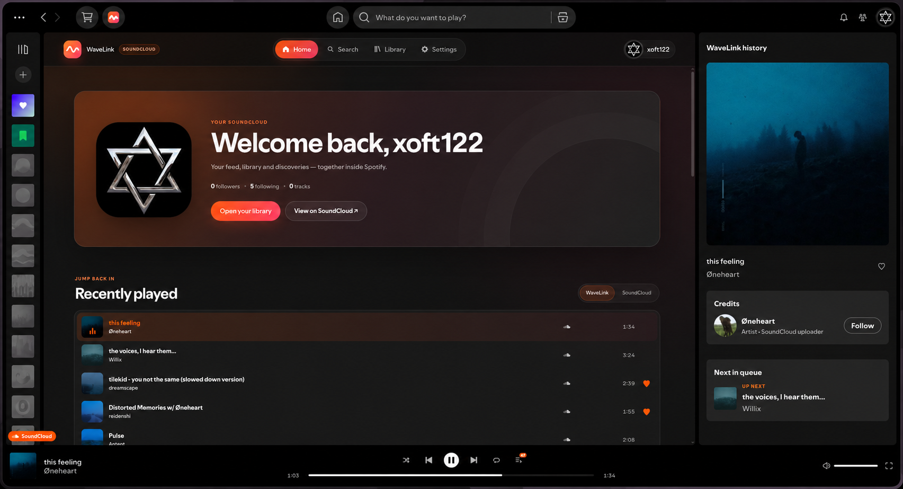

<div align="center">
  
  <h1>WaveLink</h1>
  <p><strong>SoundCloud inside Spotify, powered by Spicetify.</strong></p>
  <p>Browse, search, manage your library, and play SoundCloud tracks through a Spotify-integrated player.</p>
  
  
  
  
  
</div>

<p align="center">
  <a href="#installation">Installation</a> ·
  <a href="#connect-your-soundcloud-account">SoundCloud setup</a> ·
  <a href="#privacy-and-security">Privacy</a> ·
  <a href="#development">Development</a>
</p>

## What is WaveLink?

WaveLink is a Spicetify custom app with a startup extension that brings a full SoundCloud experience into Spotify Desktop. It includes SoundCloud browsing and account data, its own audio engine, and deep integration with Spotify's player bar, right-side Now Playing panel, queue, and fullscreen view.

To connect your account, WaveLink uses a matching **SoundCloud OAuth access token** and **Web Client ID** from your own signed-in SoundCloud web session.

## Highlights

| Area | Included |
| --- | --- |
| Home | Account summary, SoundCloud feed, WaveLink history, and SoundCloud recently played |
| Search | Tracks, playlists, and users, with automatic lazy loading for track results |
| Library | Liked tracks, created playlists, liked playlists, and followed users |
| Profiles | Artwork, tracks, playlists, likes, follow status, and lazy track queues with exact totals |
| Playback | Progressive MP3, MP3 HLS, AAC HLS fallback, seek, volume, shuffle, repeat, repeat-one, autoplay related, and restart-safe paused resume |
| Spotify integration | Artwork, metadata, progress, transport controls, queue, credits, Next in queue, a configurable source indicator, and optional SoundCloud results in Spotify Search |
| Linux system media | SoundCloud metadata, artwork, progress, seek, and working system play/pause/previous/next controls through the existing Spotify Web Player media source |
| Fullscreen | Artwork palette backgrounds and a SoundCloud artist-image mode with avatar controls |
| Availability | Region-restricted tracks are labelled, disabled, and skipped automatically in queues |
| History | A persistent local WaveLink history with expandable lists and per-track deletion |

<p align="center">
  
</p>

WaveLink also restores the Spotify interface when handing playback back to Spotify, keeps queue context beyond the visible rows, remembers the current WaveLink page for the lifetime of the Spotify session, and restores an active SoundCloud track, queue, context, and position after Spotify restarts.

Track lists and playback queues load incrementally instead of resolving an entire collection up front. **Settings → Content loading** lets you configure the batch size from 10 to 200 tracks.

SoundCloud track search is intentionally capped at 300 results. If SoundCloud stops returning additional pages, WaveLink keeps the results already loaded and related-track autoplay can continue at the end of the queue when enabled.

## Installation
* Open the Spicetify config directory by running `spicetify config-dir` from the terminal
* Navigate to `CustomApps` and create a folder `wavelink`
* Download the files in the [dist branch](https://github.com/xoft122/wavelink/archive/refs/heads/dist.zip) and copy the files (index.js, manifest.json, etc) into the `wavelink` folder
* Add the app to the Spicetify config by running `spicetify config custom_apps wavelink` from the terminal
* Re-apply Spicetify by running `spicetify apply` from the terminal

### Updating
* Open the Spicetify config directory by running `spicetify config-dir` from the terminal
* Navigate to `CustomApps` and into the folder `wavelink`
* Download the latest files from the [dist branch](https://github.com/xoft122/wavelink/archive/refs/heads/dist.zip) and copy the files (index.js, manifest.json, etc) into the `wavelink` folder
* Re-apply Spicetify by running `spicetify apply` from the terminal

### Uninstallation
* Open the Spicetify config directory by running `spicetify config-dir` from the terminal
* Navigate to `CustomApps` and delete the folder `wavelink`
* Remove the app from the Spicetify config by running `spicetify config custom_apps wavelink-` from the terminal
* Re-apply Spicetify by running `spicetify apply` from the terminal

## Connect your SoundCloud account

WaveLink needs two values from the same signed-in SoundCloud browser session:

- a 32-character `client_id` value, entered as **Web Client ID**;
- the value after `Authorization: OAuth`, entered as **OAuth access token**.

### Get the values from DevTools

1. Open [soundcloud.com](https://soundcloud.com/) in a browser and sign in.
2. Open DevTools with `F12`, then select the **Network** tab.
3. Filter requests by `api-v2.soundcloud.com` and reload the page.
4. Open any request that has both `client_id` in its URL and an `Authorization: OAuth ...` request header.
5. In the request URL, copy the value after `client_id=`.
6. In **Request Headers**, copy the token value after `Authorization: OAuth`.
7. Open WaveLink in Spotify, paste both values, and select **Connect SoundCloud**.

The OAuth token and Web Client ID must come from the same session. WaveLink verifies the pair against SoundCloud's `/me` endpoint before saving it.

> [!CAUTION]
> Treat the OAuth token like a password. Never post it in an issue, screenshot, log, or chat. If it is exposed, sign out of SoundCloud sessions and obtain a new token.

## Playback and Spotify integration

SoundCloud tracks are played by WaveLink's own audio engine, while WaveLink takes over the relevant Spotify surfaces:

- lower player-bar artwork, title, artist, progress, volume, and transport buttons;
- SoundCloud shuffle, repeat, repeat-one, and queue controls;
- right-side Now Playing metadata, credits, like state, source context, and Next in queue;
- fullscreen artwork and artist-image modes;
- automatic restoration when Spotify playback resumes.

WaveLink prefers progressive MP3, then Spotify-compatible MPEG audio HLS, and finally AAC HLS through `hls.js` where supported.

Playback belongs to the current Spotify Desktop window. SoundCloud tracks do not become Spotify catalog items and cannot be handed off through Spotify Connect.

### Linux system media controls

On desktop Linux, WaveLink uses the browser Media Session attached to its existing `#wavelink-audio` element. Chromium/CEF then exposes that real audio session to MPRIS consumers such as `playerctl`. While a WaveLink track is loaded, the system session receives its title, artist, context, artwork, playback state, progress, and play/pause/stop/previous/next/seek actions. WaveLink clears its metadata and handlers synchronously when playback returns to Spotify.

This is entirely inside the Spicetify extension—there is no helper process or extra runtime. Windows and macOS media sessions are deliberately left untouched.

## Protected SoundCloud actions

Some SoundCloud account mutations require website session state that WaveLink intentionally does not collect. For those actions, WaveLink does not attempt the protected mutation itself.

| Action | WaveLink behavior |
| --- | --- |
| Add a track or playlist like | Opens the exact SoundCloud page and refreshes after you return |
| Follow or unfollow | Opens the creator profile and refreshes the status after you return |
| Repost or remove a repost | Opens the entity page and refreshes the status after you return |
| Create or edit a playlist | Opens the relevant SoundCloud workflow and refreshes after you return |

WaveLink never claims that a protected action succeeded when SoundCloud denied it.

## Privacy and security

- Spotify Desktop does not expose a secure keychain to Spicetify custom apps, so the OAuth pair is stored **unencrypted** in Spotify's local app storage;
- other installed Spicetify code and Spotify DevTools running as the same OS user may be able to read that storage;
- SoundCloud API and media requests pass through Spicetify's public CORS relay at `https://cors-proxy.spicetify.app`, which can technically observe the SoundCloud OAuth header;
- requests use `credentials: "omit"` and do not forward Spotify cookies or Spotify access tokens;
- direct requests are restricted to allowlisted SoundCloud API and media hosts;
- arbitrary pagination and media URLs are rejected;
- WaveLink does not require or store a Client Secret;
- an unauthorized SoundCloud response clears the invalid saved pair;
- **Settings → Disconnect and delete credentials** removes the stored OAuth token and Web Client ID.

Install only Spicetify code you trust. Review the source and the relay trade-off before connecting a SoundCloud account.

## Known limitations

- WaveLink relies on SoundCloud's web API contracts, which may change without notice.
- SoundCloud may reject protected account mutations outside its own website; WaveLink uses safe browser handoffs for those actions.
- Every successful WaveLink playback start is saved in local history, and WaveLink also attempts a best-effort SoundCloud history write. A remote failure never erases the local entry; SoundCloud recently played remains available as a separate view.
- Removed, private, region-restricted, or unsupported tracks cannot be played.
- System-media behavior depends on Spotify's embedded Chromium build and the desktop's MPRIS support.
- Spotify UI updates can temporarily break selectors used by the player bar, right panel, or fullscreen integration.
- SoundCloud sees requests routed through `https://cors-proxy.spicetify.app`, so region-dependent availability may reflect the relay location rather than your own.


## Development

### Requirements

- Node.js `20.17` or newer;
- npm.

### Build

```terminal
npm ci
npm run typecheck
npm run test:sandbox
npm run build
```

For active development:

```terminal
npm run watch
```

### Project layout

```text
src/
  components/   React views and UI
  extensions/   Startup integration
  hooks/        Shared React hooks
  services/     SoundCloud API, playback, navigation, history, and Spotify UI integration
  types/        SoundCloud and Spicetify types
tests/          Node test suite and source-contract regressions
dist/           Compiled release files (generated)
```

The full source archive also includes `package.json`, the reproducible `package-lock.json` and TypeScript configuration.

## License

WaveLink is released under the [MIT License](LICENSE).
